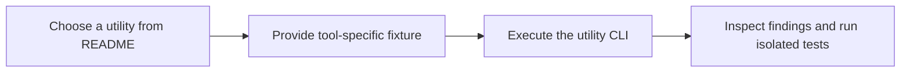

# 365 Mini Projects

Small, real utilities built one day at a time, with runnable code and repeatable verification.

## Recent Builds

| Date | Project | Description | Verification |
| --- | --- | --- | --- |
| 2026-07-23 | [JSONL Auditor](projects/2026-07-23-jsonl-auditor) | Audits JSON Lines files for malformed records, duplicate IDs, and inconsistent object shapes. | `python3 -m unittest discover projects/2026-07-23-jsonl-auditor -v` |
| 2026-07-21 | [Env Contract Checker](projects/2026-07-21-env-contract-checker) | Validates `.env` files against an example contract without exposing secret values. | `python3 -m unittest discover projects/2026-07-21-env-contract-checker -v` |
| 2026-07-20 | [CSV Schema Drift Detector](projects/2026-07-20-csv-schema-drift-detector) | Detects added, removed, and type-shifted CSV columns for data-pipeline checks. | `python3 -m unittest discover projects/2026-07-20-csv-schema-drift-detector -v` |
| 2026-06-24 | [Markdown Link Checker](projects/2026-06-24-markdown-link-checker) | Finds duplicate anchors, empty URLs, and malformed Markdown links. | `python3 -m unittest discover projects/2026-06-24-markdown-link-checker -v` |
| 2026-06-24 | [Task Triage CLI](projects/2026-06-24-task-triage-cli) | Sorts tasks by priority, due date, and effort. | `python3 -m unittest discover projects/2026-06-24-task-triage-cli -v` |

Each project lives in a dated folder under `projects/` and uses minimal dependencies.

## Local verification

Run `make verify` with Make and Python 3 installed. Each dated utility is tested in its own directory.

## Business problem

Small operational checks are hard to reuse when their inputs and tests are scattered. Each utility needs a documented command and an isolated fixture.

## Project walkthrough

[Architecture and data flow](docs/ARCHITECTURE.md) · [Business problem, demo, and verification](docs/CASE_STUDY.md)
