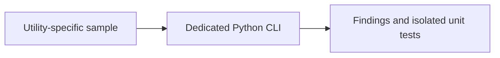

# Lokesh Python Toolkit architecture

Collect small repeatable checks for Markdown, task lists, schema drift, environment contracts, and JSONL.

## Operational boundaries

The tools run as independent utilities. Each folder defines its own input contract and exit behavior.
